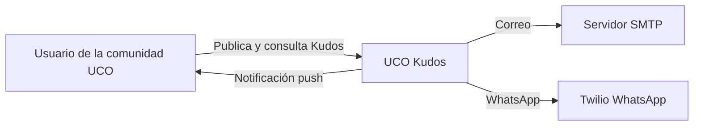
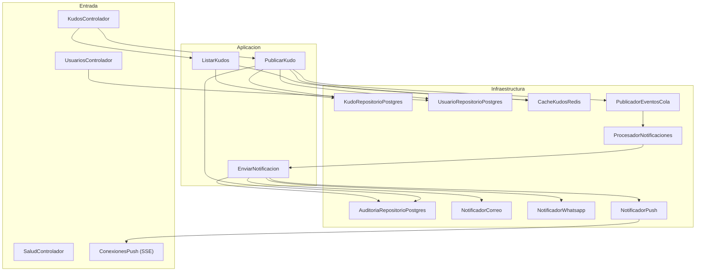
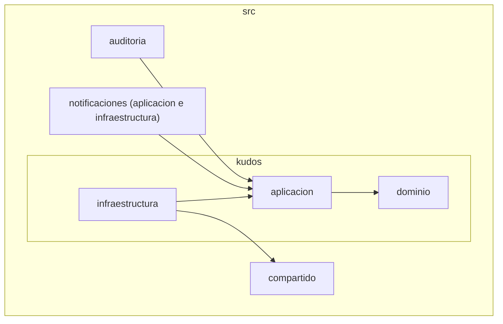
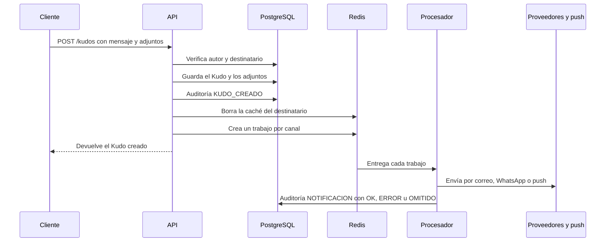
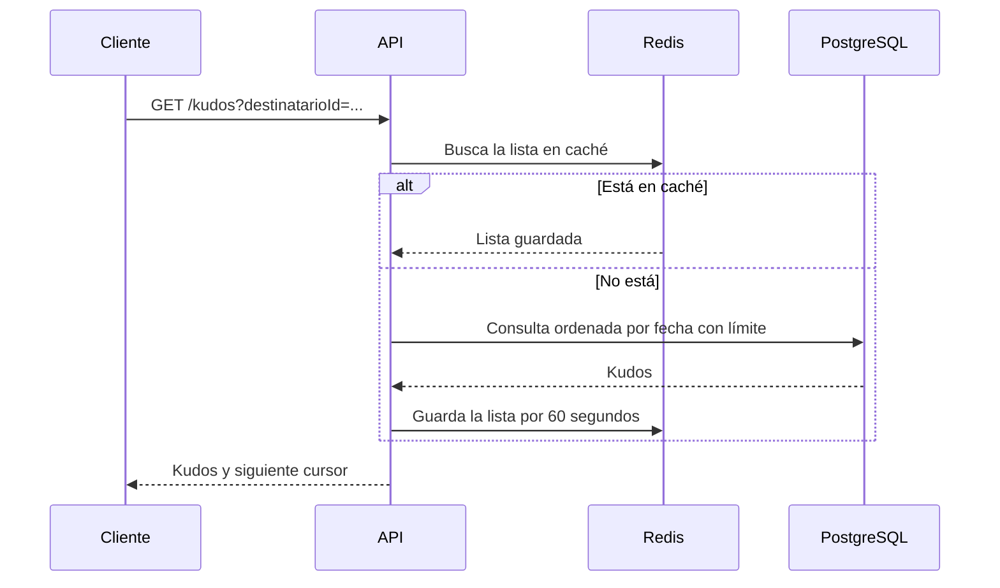
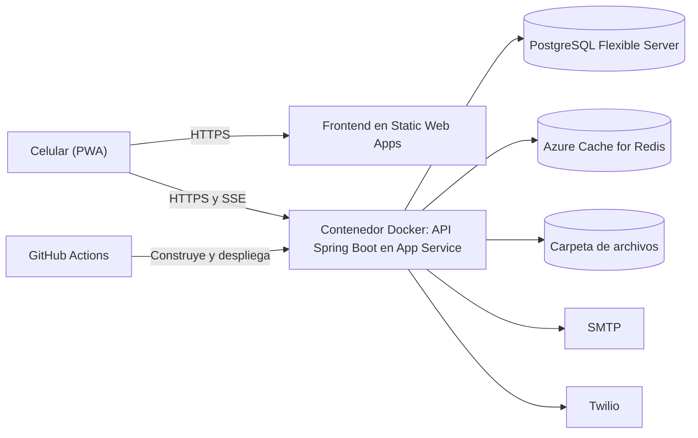
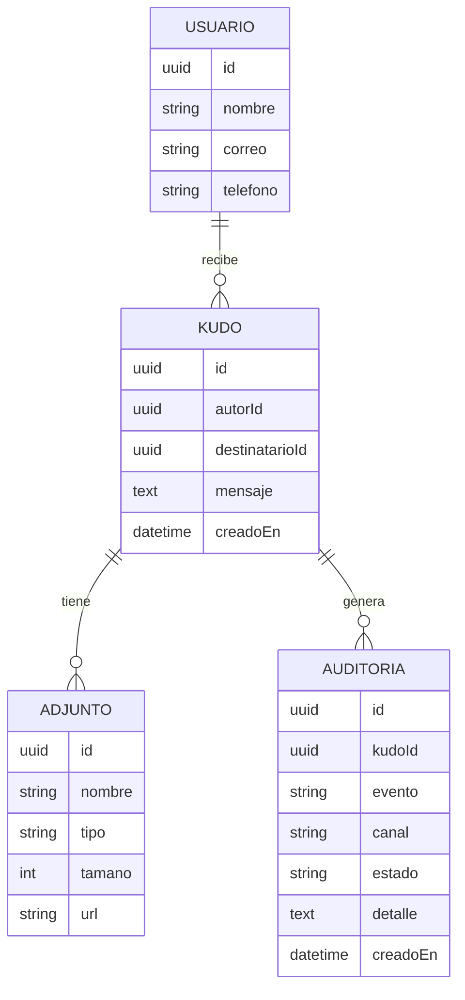
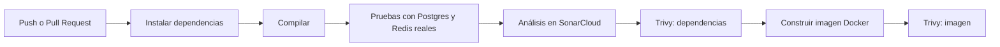

# UCO Kudos – Backend

Proyecto Integrador Final de Ingeniería del Software II, Universidad Católica de Oriente (2026).
Autor: Diego Alejandro Vega (trabajo individual).

UCO Kudos es una plataforma para que la comunidad universitaria se publique reconocimientos (Kudos). Este repositorio tiene el backend en Java 21 con Spring Boot, y en este mismo README está toda la documentación de la línea base arquitectónica.

Al publicar un Kudo el sistema:

1. Guarda el reconocimiento con sus adjuntos.
2. Envía un correo al destinatario.
3. Envía un WhatsApp al destinatario.
4. Envía una notificación push en tiempo real si el destinatario está conectado.
5. Registra la auditoría de cada paso.

## Contenido

1. [Estado actual](#1-estado-actual)
2. [Cómo correrlo](#2-cómo-correrlo)
3. [Propósito y motivadores](#3-propósito-y-motivadores)
4. [Atributos de calidad](#4-atributos-de-calidad)
5. [Estilo y tácticas arquitectónicas](#5-estilo-y-tácticas-arquitectónicas)
6. [ABB y SBB](#6-abb-y-sbb)
7. [Línea base tecnológica](#7-línea-base-tecnológica)
8. [Diagramas](#8-diagramas)
9. [Diseño detallado](#9-diseño-detallado)
10. [Lecturas, sistemas reactivos y Twelve-Factor](#10-lecturas-sistemas-reactivos-y-twelve-factor)
11. [Observabilidad](#11-observabilidad)
12. [Decisiones de arquitectura (ADR)](#12-decisiones-de-arquitectura-adr)
13. [Pruebas](#13-pruebas)
14. [Seguridad y DevSecOps](#14-seguridad-y-devsecops)
15. [Despliegue en Azure](#15-despliegue-en-azure)
16. [Evidencias](#16-evidencias)
17. [Uso de inteligencia artificial](#17-uso-de-inteligencia-artificial)
18. [Pendientes y mejoras](#18-pendientes-y-mejoras)

---

## 1. Estado actual

| Entregable | Estado |
|---|---|
| Flujo de publicar Kudo en el backend | Hecho. Compila en Java 21 |
| 23 pruebas unitarias | Pasan (`mvn test`, BUILD SUCCESS) |
| 7 pruebas de integración | Escritas. Falta registrar su primera ejecución |
| Archivos de los pipelines CI y CD | Hechos. Falta configurarlos en GitHub y correrlos |
| Sonar y Trivy en verde | Pendiente |
| Despliegue en Azure y URL pública | Pendiente |
| Frontend (repositorio aparte, React PWA) | Escrito, con 10 pruebas que pasan y compila. Falta desplegarlo |
| Login con JWT | Pendiente |

Enlaces:

- Repositorio Front-End: pendiente de subir a GitHub (`uco-kudos-frontend`)
- URL pública: pendiente

---

## 2. Cómo correrlo

### Requisitos

- JDK 21 (por ejemplo Temurin 21). Con versiones más nuevas, como la 26, las herramientas de prueba pueden fallar.
- Maven 3.9 o superior
- Docker Desktop
- Git

Comprueba con `java -version` y `mvn -v`. Las dos deben mostrar Java 21.

### En local

1. Clona el repositorio y entra a la carpeta.
2. Copia el archivo de variables: `copy .env.example .env` (en Linux o Mac: `cp .env.example .env`).
3. Abre `.env` y llena los valores. Para correo y WhatsApp mira la sección "Correo y WhatsApp".
4. Levanta la base de datos y Redis: `docker compose up -d base-datos redis`
5. Arranca la API: `mvn spring-boot:run`
6. Abre `http://localhost:3000/salud`. Debe responder `{"estado":"ok"}`.

La aplicación lee el archivo `.env` de la carpeta desde donde la ejecutas.

### Todo en Docker

```
docker compose up --build
```

Levanta la API, Postgres y Redis. Para apagar sin perder datos: `docker compose down`. Evita `-v`, que borra el volumen de la base de datos.

### Endpoints

| Método y ruta | Qué hace |
|---|---|
| `GET /salud` | Dice si la API está viva |
| `GET /usuarios` | Lista de usuarios (solo id y nombre) |
| `POST /usuarios` | Crea un usuario (nombre, correo y teléfono) |
| `POST /kudos` | Publica un Kudo (multipart: autorId, destinatarioId, mensaje y archivos) |
| `GET /kudos?destinatarioId=...&limite=10&cursor=...` | Kudos recibidos, con paginación por cursor |
| `GET /push/{usuarioId}` | Canal de notificaciones en tiempo real (SSE) |
| `GET /archivos/{nombre}` | Descarga un adjunto |

### Probar el flujo completo

Crea dos usuarios:

```
curl -X POST http://localhost:3000/usuarios -H "Content-Type: application/json" -d "{\"nombre\":\"Ana\",\"correo\":\"ana@uco.edu.co\",\"telefono\":\"+573000000001\"}"
curl -X POST http://localhost:3000/usuarios -H "Content-Type: application/json" -d "{\"nombre\":\"Luis\",\"correo\":\"luis@uco.edu.co\",\"telefono\":\"+573000000002\"}"
```

Cada respuesta trae un `id`. Úsalos para publicar un Kudo con un adjunto:

```
curl -X POST http://localhost:3000/kudos -F autorId=ID_DE_ANA -F destinatarioId=ID_DE_LUIS -F mensaje="Gracias por ayudarme con el proyecto" -F "archivos=@nota.pdf;type=application/pdf"
```

Consultar los Kudos de Luis:

```
curl "http://localhost:3000/kudos?destinatarioId=ID_DE_LUIS&limite=10"
```

Ver la auditoría:

```
docker compose exec base-datos psql -U kudos -d kudos -c "select evento, canal, estado, detalle from auditoria order by creado_en"
```

Resultado esperado: una fila `KUDO_CREADO` y una fila `NOTIFICACION` por cada canal (correo, whatsapp y push).

Para probar el push, en una terminal aparte deja conectado este comando antes de publicar el Kudo:

```
curl -N http://localhost:3000/push/ID_DE_LUIS
```

Al publicar el Kudo para Luis, esa terminal muestra un evento `kudo-recibido`. Si nadie está conectado, la auditoría del canal push queda como OMITIDO.

### Correo y WhatsApp

**Correo (Gmail):** activa la verificación en dos pasos, crea una contraseña de aplicación y en `.env` pon `CORREO_HOST=smtp.gmail.com`, `CORREO_PUERTO=587`, `CORREO_USUARIO` con tu correo, `CORREO_CLAVE` con la contraseña de aplicación y `CORREO_REMITENTE` con tu correo.

**WhatsApp (Twilio sandbox):** crea una cuenta en Twilio, activa el sandbox de WhatsApp y envía el código de unión desde el celular que va a recibir los mensajes. En `.env` pon `WHATSAPP_CUENTA_SID`, `WHATSAPP_TOKEN` y `WHATSAPP_NUMERO_ORIGEN`. El teléfono del usuario destinatario debe ser el que se unió al sandbox, con el prefijo del país.

### Variables de entorno

Todas están en `.env.example`. Ninguna tiene valor quemado en el código.

| Variable | Para qué sirve |
|---|---|
| `PUERTO` | Puerto de la API |
| `BD_HOST`, `BD_PUERTO`, `BD_USUARIO`, `BD_CLAVE`, `BD_NOMBRE` | Conexión a PostgreSQL |
| `BD_SSLMODE` | `prefer` en local y `require` en Azure |
| `BD_ESQUEMA` | `update` crea y actualiza las tablas solo; `validate` solo revisa |
| `REDIS_HOST`, `REDIS_PUERTO`, `REDIS_CLAVE`, `REDIS_SSL` | Conexión a Redis (en Azure: puerto 6380, clave y SSL en `true`) |
| `CORREO_*` | Servidor SMTP |
| `WHATSAPP_*` | Cuenta de Twilio |
| `ARCHIVOS_CARPETA`, `ARCHIVOS_TAMANO_MAXIMO`, `ARCHIVOS_TIPOS_PERMITIDOS` | Reglas de los adjuntos |
| `CACHE_SEGUNDOS` | Vida de la caché |
| `CORS_ORIGENES` | Orígenes permitidos (en producción, el dominio del frontend) |
| `COLA_NOMBRE`, `COLA_INTENTOS`, `COLA_ESPERA_BASE`, `COLA_CANALES` | Cola de notificaciones (tienen valores por defecto) |

### Problemas comunes

| Problema | Qué revisar |
|---|---|
| `Could not resolve placeholder` al arrancar | Que `.env` exista en la carpeta desde donde ejecutas y tenga todas las variables de `.env.example` |
| Error de conexión a la base | Que el contenedor `base-datos` esté arriba (`docker compose ps`) |
| Las pruebas fallan raro al arrancar | Que `java -version` muestre Java 21 |
| El correo falla con `Connection refused` o autenticación | Que `CORREO_HOST`, `CORREO_PUERTO` y la contraseña de aplicación sean los reales |
| WhatsApp falla | Que el teléfono se haya unido al sandbox de Twilio |
| Error 400 al subir un archivo | Que el tipo esté permitido, no pase el tamaño máximo y sean máximo 5 archivos |

---

## 3. Propósito y motivadores

### Propósito

En una universidad hay mucha gente que ayuda a otros todos los días: un compañero que explica un tema, un profesor que se queda después de clase, alguien de bienestar que resuelve un problema. Casi nunca queda registro de ese agradecimiento. UCO Kudos busca que cualquier persona de la comunidad pueda publicar un reconocimiento a otra y que el destinatario se entere rápido, por el canal que más use.

Para esta entrega no construí toda la plataforma. Construí la **línea base arquitectónica**, la estructura sobre la que se puede crecer, y la comprobé con el flujo más importante: publicar un Kudo.

### Requisitos funcionales

| Código | Requisito | Estado |
|---|---|---|
| RF-01 | Publicar un Kudo a otro usuario, con mensaje y archivos adjuntos | Hecho |
| RF-02 | Guardar el Kudo en la base de datos | Hecho |
| RF-03 | Enviar correo al destinatario | Hecho (falta probar con un SMTP real) |
| RF-04 | Enviar WhatsApp al destinatario | Hecho (falta probar con Twilio real) |
| RF-05 | Enviar push en tiempo real (SSE) si el destinatario está conectado | Hecho |
| RF-06 | Registrar auditoría de cada paso del proceso | Hecho |
| RF-07 | Consultar los Kudos recibidos con paginación | Hecho |
| RF-08 | Iniciar sesión | Pendiente |

"Hecho" significa que el código está escrito y compilado. La verificación automática completa (integración, Sonar y Trivy) se confirma con el CI.

### Requisitos no funcionales

| Código | Requisito |
|---|---|
| RNF-01 | El 90% de los usuarios entra desde dispositivos móviles |
| RNF-02 | Hay muchas más lecturas que escrituras |
| RNF-03 | Publicar un Kudo no puede quedarse esperando a que se envíen los mensajes |
| RNF-04 | Un canal caído no debe afectar a los demás |
| RNF-05 | Todo lo que pase con un Kudo debe quedar trazado |
| RNF-06 | Se debe poder cambiar de proveedor de correo o WhatsApp sin reescribir la lógica |

### Restricciones

- Trabajo individual, con plazo hasta el viernes 13 de noviembre de 2026 a las 12:00.
- Debe incluir CI, CD, SonarCloud, Trivy y despliegue automatizado.
- Debe soportar correo, WhatsApp y push, y permitir archivos adjuntos.
- La configuración no puede estar quemada en el código.
- Los datos de las personas (correo y teléfono) deben tratarse con cuidado.
- Debe funcionar con costos mínimos, usando el crédito de estudiante de Azure y capas gratuitas.

---

## 4. Atributos de calidad

### AC-01 Rendimiento en lectura

| Campo | Descripción |
|---|---|
| Código | AC-01 |
| Nombre | Respuesta rápida al consultar Kudos |
| Objetivo | Que ver los Kudos recibidos sea rápido aunque haya mucha gente consultando |
| Criterio de éxito | La consulta repetida no vuelve a golpear la base de datos |
| Prerrequisitos | Redis disponible |
| Fuente del estímulo | Usuario desde el celular |
| Estímulo | Pide la lista de sus Kudos varias veces seguidas |
| Ambiente | Operación normal con alta carga de lectura |
| Artefacto | Caso de uso `ListarKudos` y `CacheKudosRedis` |
| Respuesta | Devuelve la lista desde la caché si existe; si no, consulta la base y la guarda |
| Medida de la respuesta | La segunda consulta idéntica dentro de la vida de la caché (60 s) no ejecuta consulta SQL |

### AC-02 Resiliencia de las notificaciones

| Campo | Descripción |
|---|---|
| Código | AC-02 |
| Nombre | Un canal caído no tumba a los demás |
| Objetivo | Que el Kudo se publique aunque falle el correo o WhatsApp |
| Criterio de éxito | El Kudo queda guardado y los canales sanos se entregan |
| Prerrequisitos | Cola en Redis activa |
| Fuente del estímulo | Proveedor externo (SMTP o Twilio) |
| Estímulo | El proveedor no responde o devuelve error |
| Ambiente | Operación normal |
| Artefacto | `ProcesadorNotificaciones`, `EnviarNotificacion` y la cola en Redis |
| Respuesta | Cada canal es un trabajo aparte con 3 reintentos y espera creciente; el error queda en auditoría |
| Medida de la respuesta | La API responde 201 aunque falle un canal, y la tabla `auditoria` muestra el estado ERROR de ese canal |

### AC-03 Modificabilidad

| Campo | Descripción |
|---|---|
| Código | AC-03 |
| Nombre | Agregar un canal de notificación nuevo |
| Objetivo | Poder sumar, por ejemplo, Telegram sin tocar la lógica del negocio |
| Criterio de éxito | Solo se agrega una clase y se registra |
| Prerrequisitos | Contrato `Notificador` definido |
| Fuente del estímulo | Desarrollador |
| Estímulo | Se pide un canal nuevo |
| Ambiente | Desarrollo |
| Artefacto | Interfaz `Notificador` y `EnviarNotificacion` |
| Respuesta | Se crea una clase que cumple el contrato y Spring la registra |
| Medida de la respuesta | Los casos de uso `PublicarKudo` y `EnviarNotificacion` no cambian |

### AC-04 Seguridad en los adjuntos

| Campo | Descripción |
|---|---|
| Código | AC-04 |
| Nombre | Subida segura de archivos |
| Objetivo | Evitar archivos peligrosos o demasiado grandes |
| Criterio de éxito | Solo se aceptan los tipos y tamaños permitidos |
| Prerrequisitos | Variables `ARCHIVOS_TIPOS_PERMITIDOS` y `ARCHIVOS_TAMANO_MAXIMO` configuradas |
| Fuente del estímulo | Usuario |
| Estímulo | Intenta subir un archivo ejecutable o de 50 MB |
| Ambiente | Operación normal |
| Artefacto | `KudosControlador` y `AlmacenArchivos` |
| Respuesta | Rechaza el archivo con error 400; los permitidos se guardan con nombre aleatorio |
| Medida de la respuesta | Un `.exe` o un archivo mayor al límite nunca llega a la carpeta de subidas |

---

## 5. Estilo y tácticas arquitectónicas

### Estilo

Combiné tres ideas:

- **Monolito modular:** una sola aplicación con módulos separados (`kudos`, `notificaciones`, `auditoria`). Por ser un trabajo individual con pocos días. Los módulos quedan listos para separarse si hace falta.
- **Arquitectura limpia (hexagonal):** el negocio no depende de la base de datos ni de los proveedores. Habla con puertos y las implementaciones se enchufan por fuera.
- **Orientada a eventos:** publicar un Kudo genera un evento en una cola, y los canales lo consumen por su cuenta.

### Tácticas

| Atributo | Táctica | Dónde se aplica |
|---|---|---|
| Rendimiento | Caché cache-aside | `CacheKudosRedis` |
| Rendimiento | Paginación por cursor | `ListarKudos` |
| Rendimiento | Índice en `kudo (destinatarioId, creadoEn)` | Entidad del Kudo |
| Rendimiento | Procesamiento asíncrono | Cola en Redis y `ProcesadorNotificaciones` |
| Disponibilidad | Reintentos con espera creciente | `ProcesadorNotificaciones` |
| Disponibilidad | Aislamiento de fallos (un trabajo por canal) | Cola de notificaciones |
| Modificabilidad | Puertos y adaptadores | Interfaces en `kudos/aplicacion/puertos` |
| Modificabilidad | Configuración externa | `ConfiguracionKudos` y `application.yml` |
| Seguridad | Validación de entradas | Bean Validation y reglas del dominio |
| Seguridad | Limitar y filtrar archivos | `AlmacenArchivos` |
| Seguridad | Cabeceras seguras | Spring Security |
| Trazabilidad | Auditoría por evento | `AuditoriaRepositorioPostgres` |

---

## 6. ABB y SBB

Primero definí **qué se necesita** (ABB, bloque de construcción de arquitectura) y después **con qué se resuelve** (SBB, bloque de construcción de solución).

| ABB (qué se necesita) | SBB (con qué lo resolví) | Estado |
|---|---|---|
| ABB-01 Gestión de Kudos | Módulo `kudos` | Hecho |
| ABB-02 Gestión de adjuntos | `AlmacenArchivos`, carpeta de subidas | Hecho |
| ABB-03 Notificaciones | Módulo `notificaciones` con cola en Redis | Hecho |
| ABB-04 Canal de correo | `NotificadorCorreo` (JavaMailSender) | Hecho |
| ABB-05 Canal de WhatsApp | `NotificadorWhatsapp` (Twilio) | Hecho |
| ABB-06 Canal push | `NotificadorPush` y `ConexionesPush` (Server-Sent Events) | Hecho |
| ABB-07 Auditoría | Módulo `auditoria`, tabla `auditoria` | Hecho |
| ABB-08 Mensajería asíncrona | Lista de Redis como cola | Hecho |
| ABB-09 Caché | Redis, `CacheKudosRedis` | Hecho |
| ABB-10 Identidad y acceso | JWT con Spring Security | Pendiente |
| ABB-11 Observabilidad | Endpoint `/salud`, auditoría | Parcial |
| ABB-12 Entrega continua | GitHub Actions, SonarCloud, Trivy | Archivos listos, falta ejecutarlos |

---

## 7. Línea base tecnológica

| Pieza | Tecnología | Por qué |
|---|---|---|
| Backend | Java 21 con Spring Boot 3.3 y Maven | Es lo que mejor domino y ya trae inyección de dependencias, JPA, validación y pruebas |
| Frontend | React con Vite (PWA) | Liviano e instalable en el celular |
| Base de datos | PostgreSQL con Spring Data JPA | Datos relacionales |
| Caché y cola | Redis (Spring Data Redis) | Un solo servicio para las dos cosas |
| Tiempo real | Server-Sent Events (SSE) | Canal simple del servidor al navegador que se reconecta solo |
| Correo | SMTP con Spring Mail | Funciona con cualquier proveedor |
| WhatsApp | API de Twilio (con `RestClient`) | Tiene sandbox gratis |
| Calidad | SonarCloud | Análisis estático |
| Seguridad | Trivy | Vulnerabilidades en dependencias e imagen |
| CI/CD | GitHub Actions | Está dentro del repositorio |
| Contenedores | Docker | Corre igual en mi PC y en la nube |

---

## 8. Diagramas

Están hechos en Mermaid, así que GitHub los dibuja directamente.

### Contexto



### Componentes del backend



### Paquetes del backend



### Secuencia: publicar un Kudo



### Secuencia: consultar Kudos



### Despliegue



### Modelo de datos



---

## 9. Diseño detallado

### Clean Architecture

```
src/main/java/co/edu/uco/kudos/
  kudos/
    dominio/          Entidades y reglas (Kudo, Usuario, Adjunto)
    aplicacion/       Casos de uso (PublicarKudo, ListarKudos) y puertos
    infraestructura/  Postgres, Redis, la cola y los controladores
  notificaciones/     Canales de correo, WhatsApp y push
  auditoria/          Registro de cada paso
  compartido/         Configuración leída de variables de entorno
```

Las dependencias apuntan hacia adentro: la infraestructura conoce a la aplicación, la aplicación conoce al dominio, y el dominio no conoce a nadie.

Puertos principales: `KudoRepositorio`, `UsuarioRepositorio`, `AuditoriaRepositorio`, `PublicadorEventos`, `CacheKudos` y `Notificador`.

### Modelo de datos

| Tabla | Campos |
|---|---|
| usuario | id, nombre, correo, telefono |
| kudo | id, autorId, destinatarioId, mensaje, creadoEn |
| adjunto | id, nombre, tipo, tamano, url, kudo |
| auditoria | id, kudoId, evento, canal, estado, detalle, creadoEn |

### SOLID

| Principio | Dónde se ve |
|---|---|
| Responsabilidad única | Cada caso de uso hace una sola cosa |
| Abierto/cerrado | Un canal nuevo es una clase nueva, sin cambiar lo existente |
| Sustitución de Liskov | Correo, WhatsApp y push cumplen el mismo contrato `Notificador` |
| Segregación de interfaces | Puertos pequeños y separados |
| Inversión de dependencias | Los casos de uso piden puertos en el constructor y Spring inyecta la implementación |

### Patrones de diseño

| Patrón | Dónde |
|---|---|
| Repository | `KudoRepositorioPostgres`, `UsuarioRepositorioPostgres` |
| Adapter | Cada notificador adapta un servicio externo |
| Strategy | `EnviarNotificacion` elige el notificador según el canal |
| Publicador/Suscriptor | `PublicadorEventosCola` y `ProcesadorNotificaciones` |

---

## 10. Lecturas, sistemas reactivos y Twelve-Factor

### Respuesta al alto volumen de lecturas

1. Caché en Redis de 60 segundos para la lista de cada destinatario.
2. Invalidación de esa caché cada vez que llega un Kudo nuevo.
3. Paginación por cursor (la fecha del último Kudo) en vez de `OFFSET`.
4. Índice en la tabla de Kudos para esa consulta.
5. Envíos pesados fuera del camino de lectura.
6. API sin estado, para poder levantar varias copias.

Limitación conocida: los archivos hoy los sirve la misma API. Con mucho tráfico lo correcto sería un almacenamiento de objetos o un CDN.

### Manifiesto de Sistemas Reactivos

| Pilar | Cómo lo apliqué |
|---|---|
| Responsivo | La API responde sin esperar los envíos |
| Resiliente | Cada canal tiene su trabajo, con 3 reintentos y espera creciente |
| Elástico | API sin estado; el procesador puede correr en otro proceso |
| Orientado a mensajes | Publicar y enviar se comunican por una cola |

### The Twelve-Factor App

| Factor | Cómo lo cumplo |
|---|---|
| I. Código base | Un repositorio por componente |
| II. Dependencias | Declaradas en el `pom.xml` |
| III. Configuración | Todo sale de variables de entorno (`.env.example`) |
| IV. Servicios de respaldo | Postgres, Redis, SMTP y Twilio se conectan por configuración |
| V. Build, release, run | El pipeline compila, construye la imagen y después despliega |
| VI. Procesos | La API no guarda estado entre peticiones |
| VII. Vinculación de puertos | Escucha el puerto de la variable `PUERTO` |
| VIII. Concurrencia | Se escala levantando más procesos |
| IX. Desechabilidad | Cierre ordenado con `server.shutdown: graceful` |
| X. Paridad | El mismo Docker en local y en la nube |
| XI. Logs | Spring Boot escribe a la salida estándar |
| XII. Administración | Tareas con comandos de Maven |

---

## 11. Observabilidad

- **Salud:** `GET /salud` responde si la API está viva.
- **Auditoría:** cada Kudo deja rastro en la tabla `auditoria` (evento, canal y estado OK, ERROR u OMITIDO).
- **Logs:** salen por la salida estándar y se ven con `docker logs`.

---

## 12. Decisiones de arquitectura (ADR)

Cada decisión sigue el mismo formato: contexto, decisión, alternativas y consecuencias.

**ADR-01 Monolito modular.** Contexto: trabajo individual con pocos días y sin presupuesto. Decisión: una sola aplicación Spring Boot con paquetes separados por dominio. Alternativa: microservicios. Consecuencias: más fácil de desarrollar, desplegar y explicar; escala como una sola unidad, pero los módulos están separados para poder dividirlos después.

**ADR-02 Arquitectura limpia (hexagonal).** Contexto: debe poder cambiarse de proveedor de correo o WhatsApp, y los casos de uso deben poder probarse sin base de datos. Decisión: dominio, aplicación e infraestructura separados, con puertos entre ellos. Alternativa: capas tradicionales donde el servicio usa directamente el repositorio y el proveedor. Consecuencias: hay más archivos, pero las pruebas unitarias son simples y cambiar un proveedor es cambiar una clase.

**ADR-03 Java 21 con Spring Boot y Maven.** Contexto: necesito un framework con inyección de dependencias, persistencia, validación y pruebas, y debo poder explicarlo y modificarlo en vivo en la sustentación. Decisión: Java 21 con Spring Boot 3.3 y Maven; para el frontend, una PWA. Alternativas: NestJS con TypeScript (llegué a construir una primera versión) y Express sin estructura. Consecuencias: es la tecnología que mejor domino, así que puedo explicar cada parte y hacer cambios en vivo con más seguridad. Costó reescribir el backend, pero la arquitectura y los puertos se mantuvieron. Se requiere JDK 21.

**ADR-04 Redis para caché y cola.** Contexto: necesito caché para las lecturas y una cola para las notificaciones. Decisión: un solo Redis, con una lista como cola y un procesador propio que la lee. Alternativas: Kafka o RabbitMQ. Consecuencias: menos piezas que montar y explicar. Limitación: una lista de Redis no tiene confirmación de entrega, así que si la aplicación se cae justo después de sacar un trabajo, ese trabajo se pierde (la auditoría deja ver qué canal no quedó registrado). Si el volumen o la exigencia crecen, se puede reemplazar por un broker como RabbitMQ gracias al puerto `PublicadorEventos`.

**ADR-05 Notificaciones asíncronas, un trabajo por canal.** Contexto: enviar correo y WhatsApp es lento y puede fallar. Decisión: al publicar se crea un trabajo en la cola por cada canal, con 3 reintentos y espera creciente. Alternativa: enviar todo dentro de la misma petición. Consecuencias: la API responde rápido y un canal caído no afecta a los demás; la entrega es eventual y por eso la auditoría es importante.

**ADR-06 PWA para el frontend.** Contexto: el 90% de los usuarios entra desde el celular. Decisión: una aplicación web instalable con React. Alternativa: app nativa. Consecuencias: un solo código para todos los dispositivos y sin tiendas de apps; algunas funciones nativas quedan limitadas.

**ADR-07 Server-Sent Events para el push.** Contexto: el destinatario debe enterarse al instante si está conectado. Decisión: el navegador abre `GET /push/{usuarioId}` y el servidor le envía eventos; la aplicación guarda en memoria qué usuarios están conectados. Alternativas: WebSocket o Socket.IO, o consultar al servidor cada cierto tiempo. Consecuencias: llega al instante, el navegador lo soporta con `EventSource` y reconecta solo. Solo va del servidor al cliente, que es todo lo que necesita una notificación. Limitación: el mapa de conectados vive en memoria; con varias copias de la API habría que repartir los eventos por Redis.

**ADR-08 Paginación por cursor.** Contexto: habrá muchas lecturas y listas largas. Decisión: el cursor es la fecha del último Kudo recibido. Alternativa: `OFFSET` y `LIMIT`. Consecuencias: mantiene el rendimiento con muchos registros; no permite saltar a una página arbitraria, algo que en un feed no hace falta.

**ADR-09 Adjuntos en disco con metadatos en la base.** Contexto: los Kudos pueden llevar archivos, pero no quiero guardar binarios en la base. Decisión: los archivos van en una carpeta con nombre aleatorio y en la base solo nombre, tipo, tamaño y ruta. Alternativa: almacenamiento de objetos. Consecuencias: simple para esta entrega. En la nube los discos de los contenedores se pierden al reiniciar (en Azure se mitiga con `WEBSITES_ENABLE_APP_SERVICE_STORAGE`), y lo correcto a futuro es pasar a almacenamiento de objetos.

**ADR-10 SonarCloud y Trivy en el pipeline.** Contexto: el enunciado exige análisis estático y de vulnerabilidades. Decisión: SonarCloud para el código y Trivy para dependencias e imagen Docker, ambos en el CI. Consecuencias: son las herramientas que pide el enunciado y tienen capa gratuita. Si fallan, el pipeline se detiene.

---

## 13. Pruebas

La idea es tener muchas pruebas rápidas y baratas abajo, algunas de integración en el medio y pocas de extremo a extremo arriba.

| Nivel | Qué prueba | Herramienta | Cantidad | Estado |
|---|---|---|---|---|
| Unitarias | Casos de uso, reglas del dominio y push con puertos simulados | JUnit 5 y Mockito | 23 | Pasan |
| Integración | La API completa con Postgres y Redis reales | Spring Boot Test y MockMvc | 7 | Escritas, falta registrar su ejecución |
| Extremo a extremo | Flujo completo desde el frontend | Pendiente | 0 | Pendiente |

### Unitarias

Terminan en `Test` y no necesitan base de datos. Se corren con `mvn test`.

| Clase | Qué comprueba |
|---|---|
| `PublicarKudoTest` | Publicación correcta, mensaje vacío, destinatario inexistente y autor inexistente |
| `EnviarNotificacionTest` | Auditoría OK, OMITIDO y ERROR (con el error vuelto a lanzar para que reintente), canal inexistente y kudo inexistente |
| `ListarKudosTest` | Respuesta desde caché, consulta a la base cuando no hay caché, siguiente cursor, uso del cursor y cursor inválido |
| `ReglasMensajeTest` | Regla del mensaje: vacío, nulo, en el límite y por encima del límite |
| `NotificadorPushTest` | Push enviado si está conectado, omitido si no, y manejo de las conexiones |

### Integración

Terminan en `IT` y están en `FlujoKudoIT`. Levantan la aplicación completa contra Postgres y Redis reales; solo se reemplazan los proveedores externos (correo y WhatsApp). Se corren con `mvn verify`, con Postgres y Redis arriba y las variables de `.env` cargadas.

| Prueba | Qué comprueba |
|---|---|
| Publicar con adjunto | Guarda el Kudo y el adjunto, y la auditoría tiene `KUDO_CREADO` y una fila por cada canal |
| Paginación por cursor | Primera página con 2 Kudos y siguiente cursor; segunda página con el último y sin cursor |
| Caché | Un Kudo nuevo aparece aunque la lista ya estuviera cacheada (se invalida) |
| Mensaje vacío | Responde 400 |
| Archivo no permitido | Un `.exe` se rechaza con 400 |
| Destinatario inexistente | Responde 404 |
| Salud | `GET /salud` responde `ok` |

### Comandos

| Comando | Qué corre |
|---|---|
| `mvn test` | Solo las pruebas unitarias (no necesitan base de datos) |
| `mvn verify` | Unitarias y de integración, con cobertura (reporte en `target/site/jacoco/index.html`) |

### Pendiente

- Registrar la ejecución de las 30 pruebas y la cobertura en el CI.
- Prueba de extremo a extremo con el frontend.
- Pruebas de las notificaciones contra el sandbox real de Twilio y un SMTP real.

---

## 14. Seguridad y DevSecOps

### Desarrollo seguro

| Medida | Dónde |
|---|---|
| Validación de datos de entrada (ids, correo, longitud del mensaje) | Bean Validation y reglas del dominio |
| Consultas parametrizadas, sin SQL armado a mano | Spring Data JPA con Hibernate |
| Límite de tamaño, de cantidad y lista de tipos permitidos en adjuntos | `AlmacenArchivos` |
| Archivos guardados con nombre aleatorio | `AlmacenArchivos` |
| Cabeceras de seguridad y sesión sin estado | Spring Security (`SeguridadConfig`) |
| Secretos fuera del código y del repositorio | Variables de entorno, `.env` en `.gitignore` |
| Mensajes de error sin detalles internos | `ManejadorDeErrores` |
| Usuario sin privilegios dentro del contenedor | `Dockerfile` (`USER kudos`) |
| Imagen final solo con el JRE y el JAR | `Dockerfile` en dos etapas |

Pendiente: autenticación con JWT (hoy el autor viaja en el cuerpo de la petición), límite de peticiones por usuario, CORS restringido al dominio del frontend y no devolver correo ni teléfono en las respuestas públicas.

### Integración continua (CI)

Archivo `.github/workflows/ci.yml`. Se ejecuta en cada push y pull request a `main`.



| Paso | Herramienta | Falla si |
|---|---|---|
| Compilar | `mvn verify` | Hay errores de compilación |
| Pruebas y cobertura | JUnit y JaCoCo con servicios de Postgres y Redis | Falla alguna prueba |
| Análisis estático | SonarCloud con espera de la puerta de calidad | No pasa la puerta de calidad |
| Vulnerabilidades en dependencias | Trivy (modo sistema de archivos) | Hay vulnerabilidades críticas o altas con arreglo disponible |
| Imagen | Docker | La imagen no construye |
| Vulnerabilidades en la imagen | Trivy (modo imagen) | Hay vulnerabilidades críticas o altas con arreglo disponible |

Los reportes de cobertura y de Trivy se guardan como artefactos de la ejecución. Además, `.github/dependabot.yml` revisa cada semana las dependencias de Maven, las acciones de GitHub y la imagen de Docker.

### Entrega continua (CD)

Archivo `.github/workflows/cd.yml`. Se ejecuta solo cuando el CI termina bien en `main`.

1. Construye la imagen Docker y la publica en GitHub Container Registry (con el identificador del commit y `latest`).
2. Le dice a Azure App Service que use esa imagen.
3. Verifica `GET /salud` en la URL pública, con hasta 10 intentos.

### Secretos y variables en GitHub

Se crean en Settings, Secrets and variables, Actions.

| Nombre | Tipo | Qué es |
|---|---|---|
| `SONAR_TOKEN` | Secreto | Token generado en SonarCloud |
| `AZURE_WEBAPP_PUBLISH_PROFILE` | Secreto | Perfil de publicación que se descarga del App Service |
| `SONAR_PROJECT_KEY` | Variable | Clave del proyecto en SonarCloud |
| `SONAR_ORGANIZATION` | Variable | Organización en SonarCloud |
| `AZURE_WEBAPP_NAME` | Variable | Nombre del App Service |
| `URL_PUBLICA` | Variable | URL pública del App Service, sin la barra final |

### Estado

| Elemento | Estado |
|---|---|
| Archivo del pipeline de CI | Hecho |
| Archivo del pipeline de CD | Hecho |
| Pruebas unitarias | Pasan |
| Proyecto en SonarCloud y secretos en GitHub | Pendiente |
| Primera ejecución del CI en verde (con Trivy) | Pendiente |
| App Service en Azure creado | Pendiente |
| Primera ejecución del CD en verde | Pendiente |

---

## 15. Despliegue en Azure

El despliegue lo hace el pipeline de CD. Recursos previstos, con la cuenta de estudiante:

| Recurso | Servicio |
|---|---|
| API | App Service en Linux, plan B1, con contenedor |
| Base de datos | Azure Database for PostgreSQL Flexible Server |
| Caché y cola | Azure Cache for Redis |
| Frontend | Static Web Apps |

Variables que se cargan en el App Service (Configuración, Variables de entorno), nunca en el repositorio:

| Variable | Valor |
|---|---|
| `PUERTO` y `WEBSITES_PORT` | `8080` |
| `BD_HOST`, `BD_USUARIO`, `BD_CLAVE`, `BD_NOMBRE` | Los del servidor PostgreSQL |
| `BD_SSLMODE` | `require` |
| `REDIS_HOST`, `REDIS_CLAVE` | Los de Azure Cache for Redis |
| `REDIS_PUERTO` | `6380` |
| `REDIS_SSL` | `true` |
| `ARCHIVOS_CARPETA` | `/home/subidas` |
| `WEBSITES_ENABLE_APP_SERVICE_STORAGE` | `true` (para que los adjuntos no se pierdan al reiniciar) |
| `CORREO_*`, `WHATSAPP_*` | Los reales |
| `CORS_ORIGENES` | La URL del frontend |

Pasos:

1. Crear los recursos en el portal de Azure.
2. Cargar las variables de arriba en el App Service.
3. Descargar el perfil de publicación del App Service y guardarlo como secreto del repositorio.
4. Al hacer push a `main`, el pipeline compila, prueba, analiza y despliega.
5. Verificar con `GET /salud` en la URL pública.

Estado: pendiente. Al terminar, se borra el grupo de recursos para no gastar el crédito.

---

## 16. Evidencias

Las imágenes están en la carpeta `evidencias/` y se agregan a medida que existan.

| Evidencia | Qué debe mostrar | Archivo | Estado |
|---|---|---|---|
| Pruebas | Salida de `mvn verify` con las pruebas en verde | `pruebas.png` | Pendiente de captura |
| Flujo completo | Publicar un Kudo y ver la auditoría con los tres canales | `flujo-publicar-kudo.png` | Pendiente de captura |
| CI | Ejecución del pipeline de integración en GitHub Actions, en verde | `ci.png` | Pendiente |
| CD | Ejecución del pipeline de despliegue en verde | `cd.png` | Pendiente |
| SonarCloud | Panel del proyecto con la puerta de calidad aprobada | `sonar.png` | Pendiente |
| Trivy | Reporte de dependencias e imagen sin vulnerabilidades críticas | `trivy.png` | Pendiente |
| Despliegue | La URL pública respondiendo en `/salud` | `despliegue.png` | Pendiente |
| WhatsApp y correo | El mensaje recibido en el celular y el correo en la bandeja | `notificaciones.png` | Pendiente |
| Push | La notificación llegando en tiempo real | `push.png` | Pendiente |

---

## 17. Uso de inteligencia artificial

El enunciado permite usar IA de forma responsable, siempre que yo entienda, pueda explicar y pueda sustentar todo. Así la usé:

| Tarea | Qué hizo la IA | Qué hice yo |
|---|---|---|
| Documentación | Ayudó a ordenar y redactar con la estructura que ya usamos en otros proyectos | Escogí el alcance y las decisiones, y revisé que el texto dijera solo lo que el proyecto realmente hace |
| Código del backend | Generó el esqueleto inicial con arquitectura limpia, en Java con Spring Boot | Escogí el stack, reviso el código, lo compilo, lo corro y lo pruebo en mi equipo y en el CI |
| Decisiones de arquitectura | Propuso alternativas con sus ventajas | Elegí y justifiqué cada decisión (sección 12) |

Cómo me aseguro de entenderlo:

- Puedo seguir el flujo de publicar un Kudo desde el controlador hasta la auditoría.
- Puedo explicar por qué cada capa depende solo de la de adentro.
- Puedo agregar un canal de notificación nuevo creando una clase que cumpla el contrato `Notificador`.
- Sé qué falta y por qué: está en la sección de pendientes.

Límites que reconozco: lo generado con ayuda de IA se revisa y se prueba, no se acepta sin entenderlo, y lo que no está construido figura como pendiente y no se presenta como hecho.

---

## 18. Pendientes y mejoras

- Login con JWT
- Límite de peticiones por usuario y CORS restringido al dominio del frontend
- Endpoint de métricas
- Almacenamiento de objetos para los adjuntos
- Migraciones de base de datos en lugar de crear tablas automáticamente
- Pruebas de extremo a extremo automatizadas
- Cola con confirmación de entrega (broker) si crece la exigencia
